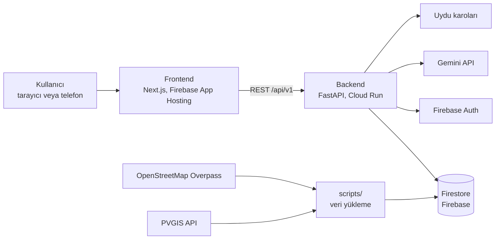

# Çatı Radarı

**SunTech** takımının "COP31'e Manisa'dan Çözümler: Sanayi ve Kampüslerde Yeşil Dönüşüm Hackathonu" projesi. Manisa OSB'deki büyük çatılar için bina bazında güneş enerjisi ve yatırım ön analizi yapan bir web uygulaması.

Bu dosya projenin tek kaynağıdır: ne yaptığımız, nasıl kurduğumuz, kimin neyi yaptığı ve hangi rakamı nereden aldığımız burada. Ekip için özet, mimari ve kişi kişi saatli görev sırası ayrıca [docs/SunTech-Gorev-Plani.pdf](docs/SunTech-Gorev-Plani.pdf) dosyasında.

> **Durum, 3 Kasım 2026 akşamı:** Uygulama canlıda ve uçtan uca çalışıyor (harita, arama, hesap, simülasyon, uydu tespiti, asistan, giriş, Kayıtlarım).
>
> - Site: https://suntech-cati-radari--suntech-cati-radari.europe-west4.hosted.app
> - API: https://suntech-backend-338282009641.europe-west3.run.app (ör. `/api/v1/binalar/ara?q=vestel`)
>
> Dağıtım ayrıntıları §13'te.

---

## 1. Proje özeti

**Sorun.** Manisa OSB'de taban alanı 1.000 m²'den büyük yaklaşık 600 çatı var, toplam alan 4,6 km² civarında. Bir firma çatısına güneş paneli koyarsa ne kazanacağını bugün tek tek teklif toplayarak öğreniyor. Bölge ölçeğinde hangi çatıdan başlanacağını gösteren açık bir tablo bulamadık.

**Ne yapıyoruz.** Haritada her büyük çatı için kurulabilir güç (kWp), yıllık üretim (MWh), yıllık tasarruf (TL), yatırım, geri ödeme süresi ve önlenen CO₂'yi gösteren bir uygulama. Rakamları deterministik bir hesap motoru üretir. Yapay zekâ iki yerde var: tabloyu araç çağırmayla okuyup soruları cevaplayan bir asistan ve uydu görüntüsünde panel arayan bir kontrol.

**Kimin işine yarar.**
- **OSB yönetimi:** bölgenin toplam potansiyeli ve en çok kazandıracak çatılar.
- **Firma:** kendi çatısının ön hesabı, tüketimine göre boyutlama, pil ve kredi seçenekleri, analizi kaydetme.
- **Jüri:** sunumda QR kodu okutup kendi telefonundan deneme.

**Tema:** Enerji Verimliliği. Başvuru başlığı: "Çatı Radarı: Manisa OSB Çatıları İçin Bina Bazında Güneş Enerjisi ve Yatırım Ön Analizi".

---

## 2. Takım ve sorumluluklar

| Kişi | Rol | Sahip olduğu alanlar |
|---|---|---|
| Nazım | Takım lideri; backend, veri, altyapı, güvenlik | `backend/` (hesap dilimi hariç), `db/`, `scripts/`, yayın, repo ayarları, kök dosyalar |
| Mahmut | Frontend | `frontend/` (iki klasör hariç), PWA, QR kod |
| Mehmet | Hesap motoru ve sunum | Hesap dilimi: `backend/app/domain/`, `backend/app/application/hesap/`, `backend/app/api/v1/hesap.py`, `backend/app/schemas/hesap.py`, `backend/tests/domain/`. Ayrıca `frontend/src/components/simulasyon/`, `frontend/src/app/varsayimlar/`, `docs/` |

Herkesin işi yaklaşık 16 saat. Sunumda Mehmet anlatır, Mahmut ekranı kullanır, Nazım teknik soruları cevaplar. Klasör sahipliğinin tamamı Bölüm 5.6'da, çalışma kuralları Bölüm 14'te.

---

## 3. Etkinlik

| | |
|---|---|
| Etkinlik | COP31'e Manisa'dan Çözümler: Sanayi ve Kampüslerde Yeşil Dönüşüm Hackathonu |
| Düzenleyen | Manisa Teknokent TTO. Paydaşlar: Manisa Celal Bayar Üniversitesi, Manisa TSO, Manisa OSB, COP31 Türkiye |
| Tarih ve yer | 3 Kasım 2026 10:00 ile 4 Kasım 2026 10:00 arası, Manisa Teknokent |
| Ödül töreni | 5 Kasım 2026 09:30, Manisa OSB |
| Ödüller | 1. 40.000 TL, 2. 30.000 TL, 3. 20.000 TL |
| İletişim | info@manisatto.com.tr, 0236 225 07 27 |

Jüri ağırlıkları: yenilikçilik %20, teknik uygulanabilirlik %20, yeşil dönüşüm ve sürdürülebilirlik etkisi %20, problem önemi ve tema uyumu %15, sanayi/kampüs uygulama ve yaygınlaştırma %15, prototip ve sunum %10.

---

## 4. Kapsam

### 4.1 Çekirdek (19:00'a kadar biter)

1. **Harita:** OSB sınırı ve 1.000 m² üstü çatılar, yıllık tasarrufa göre renkli; uydu ve sokak katmanı.
2. **Çatı kartı:** alan, kWp, MWh/yıl, TL/yıl, yatırım, geri ödeme, tCO₂/yıl ve "yıllık tüketiminiz" kutusu.
3. **OSB paneli:** toplamlar ve yıllık tasarrufa göre ilk 20 çatı; tıklayınca haritada açılır.
4. **Kaydırıcılar:** kullanılabilir oran, tarife, kurulum maliyeti, öz tüketim oranı.
5. **Asistan:** tabloyu araçlarla okur, soruları cevaplar, ön fizibilite notu yazar. Kullandığı araç cevabın altında görünür.
6. **Varsayımlar sayfası:** her değer, kaynağı ve tarihi.
7. **Yayın:** QR ile açılan, telefonda çalışan site.

### 4.2 Ek özellikler (19:00'dan sonra)

- **Üyelik, giriş, veritabanı:** Firebase Auth ile e-posta ve şifreyle kaydolup girer, analizini ve tüketimini kaydeder, "Kayıtlarım"da görür.
- **Uydu görüntüsünden panel tespiti:** çatı kartındaki düğmeyle Gemini çatının uydu görüntüsüne bakar: panel var mı, çatının ne kadarını kaplıyor. 10 çatıda elle doğruluk ölçümü yapılır.
- **Saatlik simülasyon ve pil:** PVGIS'in saatlik üretimi; tek, iki ya da üç vardiya tüketim profili; saatlik mahsuplaşma; pil kapasitesi.
- **Şebeke ve trafo:** "şebekeye vermeden" seçeneği; OSM'deki trafo merkezleri haritada, kalan kapasite elle girilir.
- **Çatı statiği ve kredi:** panelin çatıya getirdiği ek yük ve kontrol listesi; faiz, vade ve peşinatla aylık taksit, tasarrufla karşılaştırma.
- **Mobil:** telefona kurulabilen web uygulaması (PWA).

### 4.3 Zaman kalırsa

- OSM'deki firma adlarını çatılarla eşleştirip isimle arama.
- Aynı veri hattını Manisa'daki diğer OSB'ler için çalıştırıp toplamları sunuma koymak.

### 4.4 Kapsam dışı (yol haritası slaydına)

Sayaç verisiyle gerçek tüketim profili, bankalarla entegrasyon, uydu tespitini bütün çatılara yaymak, trafo kapasitesini resmî kaynaktan otomatik almak, mağaza uygulaması, şifre sıfırlama ve e-posta doğrulaması.

### 4.5 Gerideysek sadeleştirme sırası (00:00 kontrolünde)

1. Mobil: yalnızca "ana ekrana ekle", çevrimdışı çalışma yok.
2. Şebeke: yalnızca "şebekeye vermeden" hesabı, trafo verisi yok.
3. Uydu tespiti: yalnızca önceden çalıştırılmış 10 çatı.
4. Giriş: hesap açmak yerine tek tıkla "bağlantıyla kaydet".
5. Pil: saatlik simülasyon kalır, pil çıkar.

Çekirdek hiçbir zaman kesilmez.

---

## 5. Mimari

### 5.1 Genel bakış



### 5.2 Teknoloji yığını

| Katman | Seçim | Neden |
|---|---|---|
| Backend | Python 3.12, FastAPI, Pydantic v2 | Takımın backend dili; OpenAPI şemasını kendisi üretir |
| Veritabanı | Cloud Firestore (Firebase, ücretsiz Spark planı) | NoSQL belge veritabanı; ~600 bina istemciye yüklenir, mekânsal filtreleme JS'de; kurulum ve migration derdi yok |
| Firebase SDK | firebase-admin (Python) | Backend'den Firestore okuma/yazma ve token doğrulama |
| Giriş | Firebase Authentication (e-posta ve şifre) | Kayıt, giriş, token yönetimi Firebase'de; backend token'ı doğrular |
| Frontend | Next.js (App Router), TypeScript, Tailwind CSS, shadcn/ui | Mimari prompttaki yığın |
| Veri ve durum | TanStack Query (sunucu verisi), Zustand (arayüz durumu) | İkisi ayrı tutulur |
| Harita | Leaflet + react-leaflet; OpenStreetMap ve Esri World Imagery katmanları | Ücretsiz, kart gerekmez |
| Tip güvenliği | FastAPI'nin OpenAPI şemasından `openapi-typescript` ile üretilen tipler | Backend DTO'ları ile TypeScript tipleri aynı |
| Yapay zekâ | Gemini API (Google AI Studio, ücretsiz katman) | Araç çağırma ve görsel analiz |
| Grafik | Recharts | Günlük üretim ve tüketim grafiği |
| Yayın | Firebase App Hosting (frontend), Cloud Run (backend), GitHub | Tek Firebase projesi, `main`'e push'ta otomatik yayın |
| Yedek yayın | Laptopta uvicorn + cloudflared tüneli | Cloud Run'da sorun çıkarsa |

Sürümler kurulum günü güncel kararlı sürümler olacak ve kilit dosyalarıyla (`package-lock.json`, `requirements.txt`) sabitlenecek.

### 5.3 Mimari prompttan alınanlar ve bilinçli farklar

Takımın mimari promptu referans alındı. Alınanlar:

- **Clean Architecture katmanları:** domain, application, infrastructure, api. İş mantığı yalnızca domain ve application'da, router'lar ince.
- **CQRS ayrımı:** her özellikte okuma (sorgu) ve yazma (komut) use case'leri ayrı dosyalarda.
- **Repository deseni ve bağımlılık enjeksiyonu:** depolar portlar üzerinden, FastAPI `Depends` ile verilir.
- **Sonuç (Result) deseni:** use case'ler hata fırlatmak yerine `Sonuc` döner, router bunu HTTP koduna çevirir.
- **DTO, domain varlığı ve veritabanı modeli ayrımı:** dışarıya hiçbir zaman veritabanı modeli açılmaz, eşleme elle yapılır.
- **Mekânsal ön hesaplama:** alan, OSB sınırı kontrolü ve en yakın PVGIS noktası veri hattında bir kez hesaplanır ve Firestore'a yazılır. ~600 bina istemciye yüklenip JS'de bbox filtresi yapılır.
- **Tip güvenliği:** TypeScript tipleri backend şemasından üretilir, elle yazılmaz.
- **Performans:** yanıt önbelleği, haritada sadeleştirilmiş geometri (Bölüm 12).
- **Güvenlik:** rate limiting, API anahtarlarının sunucuda kalması, Docker ile yedek dağıtım (Bölüm 11).

Bilinçli farklar:

- **ASP.NET Core yerine Python FastAPI:** takımın backend dili Python ve 24 saatte aynı mimari Python'da daha hızlı kurulur. Mimari kurallar aynen geçerli.
- **MediatR yerine düz use case sınıfları:** Python'da karşılığı gereksiz bir katman olurdu.
- **Google Maps yerine Leaflet:** Google Maps faturalandırma hesabı ve kart istiyor. Uydu görüntüsünü yapay zekâyla analiz etmek de Google'ın kullanım şartlarına takılabilir.
- **Firebase Authentication:** e-posta ve şifre ile kayıt/giriş; token yönetimi ve şifre sıfırlama Firebase'de hazır. Backend `firebase-admin` ile token doğrular. argon2 ve kendi JWT sistemimiz gerekmez.
- **Kampüs modülleri yok:** kat planı, ders programı, ring servisi gibi modüller bu projeye ait değil.

### 5.4 Backend katmanları

```
api (ince router'lar) ──► application (use case'ler, portlar) ──► domain (saf hesap)
                                    ▲
infrastructure (Firestore, Firebase Auth, Gemini, PVGIS, uydu) ── portları uygular
```

- **domain:** dış bağımlılığı olmayan saf Python. Varlıklar (`Bina`, `Varsayimlar`, `HesapSonucu`) ve hesap fonksiyonları. Veritabanını, HTTP'yi ya da Gemini'yi bilmez. Birim testleri burada.
- **application:** use case'ler. Her özellik kendi klasöründe; `sorgular.py` ve `komutlar.py` ayrı. Dış dünyaya portlar (`typing.Protocol`) üzerinden erişir: `BinaDeposu`, `KayitDeposu`, `KullaniciDeposu`, `UyduIstemcisi`, `DilModeli`.
- **infrastructure:** portların gerçek uygulamaları. Firestore depoları (firebase-admin); Gemini, PVGIS, Overpass ve uydu karosu istemcileri; Firebase Auth token doğrulama.
- **api:** FastAPI router'ları. Girdiyi DTO ile doğrular, use case'i çağırır, `Sonuc`'u HTTP yanıtına çevirir. İş mantığı içermez.
- **schemas:** Pydantic DTO'ları. Özellik başına bir dosya; böylece iki kişi aynı dosyaya yazmaz.

Router'lar `app/api/v1/` klasöründen otomatik yüklenir. Yeni bir uç nokta için yeni dosya açmak yeterli, kimse `main.py`'ye dokunmaz.

Sonuç deseninin şekli:

```python
@dataclass
class Sonuc(Generic[T]):
    deger: T | None = None
    hata: Hata | None = None  # kod: "bulunamadi", "gecersiz", "yetkisiz", "kota" ...
```

### 5.5 Frontend yapısı

- **Ana sayfa (`/`):** tam ekran harita; üstte arama çubuğu ve kategori düğmeleri; masaüstünde yan panel, telefonda alttan açılan çekmece.
- **Diğer sayfalar:** `/varsayimlar`, `/giris`, `/kayitlarim`.
- **Harita:** Leaflet sunucu tarafında çalışmadığı için harita bileşeni yalnızca istemcide yüklenir (`dynamic(..., { ssr: false })`). Leaflet'in canvas çizicisi kullanılır.
- **Durum:** sunucu verisi TanStack Query'de, seçili bina ve kaydırıcı değerleri Zustand'da.
- **Kaydırıcılar:** değişiklik 300 ms bekletilir (debounce), sonra `/hesap/toplu` çağrılır.
- **Giriş:** Firebase Auth SDK ile kayıt ve giriş yapılır; dönen ID token korumalı isteklerde `Authorization: Bearer <token>` başlığına eklenir. Backend `firebase-admin` ile token'ı doğrular.
- **Tipler:** `npm run tipler` komutu backend'in OpenAPI şemasından `src/types/api.ts` dosyasını üretir. Bu dosya elle değiştirilmez.

### 5.6 Klasör yapısı ve sahiplik

```
suntech-cati-radari/
├─ PROJE.md, README.md, .gitignore, .env.example ........ Nazım
├─ .github/ (CODEOWNERS, PR şablonu) .................... Nazım
├─ docs/ (sunum, doğruluk ölçümü, görev planı) .......... Mehmet
├─ firebase/ (güvenlik kuralları, indeksler) ............ Nazım
├─ scripts/ (veri yükleme) .............................. Nazım
├─ backend/
│  ├─ requirements.txt, Dockerfile, yayın ayarları ...... Nazım
│  ├─ app/main.py, app/core/ ............................ Nazım
│  ├─ app/domain/ ....................................... Mehmet
│  ├─ app/application/hesap/ ............................ Mehmet
│  ├─ app/application/bina, sohbet, uydu, kayit, auth/ .. Nazım
│  ├─ app/application/portlar.py, sonuc.py .............. Nazım
│  ├─ app/infrastructure/ ............................... Nazım
│  ├─ app/api/v1/hesap.py ............................... Mehmet
│  ├─ app/api/v1/binalar, sohbet, uydu, kayitlar, trafo, auth . Nazım
│  ├─ app/schemas/hesap.py .............................. Mehmet
│  ├─ app/schemas/bina, sohbet, uydu, kayit, auth, ortak . Nazım
│  ├─ tests/domain/ ..................................... Mehmet
│  └─ tests/api/ ........................................ Nazım
└─ frontend/
   ├─ package.json, ayar dosyaları, public/ (PWA) ....... Mahmut
   ├─ src/app/ (sayfalar) ............................... Mahmut
   ├─ src/app/varsayimlar/ .............................. Mehmet
   ├─ src/components/simulasyon/ ........................ Mehmet
   ├─ src/components/ (diğerleri), src/lib/, src/store/ . Mahmut
   └─ src/types/api.ts (üretilen dosya) ................. Mahmut
```

**Ortak dosya kuralı.** Bağımlılık dosyaları tek kişinin: `requirements.txt`'ye Nazım, `package.json`'a Mahmut paket ekler. Başkası paket isterse sahibine söyler. Bilinen paketler (numpy, recharts gibi) kurulumda baştan eklenir.

---

## 6. Veri modeli (Firestore)

Firestore koleksiyonları:

```
binalar/{id}
  osm_id: number
  ad: string
  alan_m2: number
  verim_kwh_kwp: number
  mevcut_ges: boolean
  geom: array       // [{lon, lat}, ...]; Firestore iç içe diziyi kabul etmez
  merkez: map        // {lat, lon}, representative_point
  osb_id: string

pvgis_izgara/{id}
  nokta: map         // {lat, lon}; belge kimliği "38.605_27.295"
  yillik_kwh_kwp: number
  saatlik_wh: array  // 8760 değer
  cekilme_tarihi: timestamp

trafo_merkezleri/{id}
  osm_id: number
  ad: string
  isletmeci: string
  gerilim_kv: number
  nokta: map         // {lat, lon}
  kalan_kapasite_mw: number   // TEİAŞ tablosundan elle, şimdilik null
  kaynak: string

kayitlar/{id}
  kullanici_id: string   // Firebase Auth UID
  bina_id: string
  varsayimlar: map
  tuketim: map
  sonuc: map
  olusturma: timestamp

uydu_sonuclari/{bina_id}
  panel: string          // "var", "yok", "belirsiz"
  kaplama_orani: number
  guven: number
  model: string
  olusturma: timestamp

osb_sinirlari/{id}
  osm_id: number
  ad: string
  geom: array            // koordinat dizisi
```

- Kullanıcı bilgileri Firebase Auth'ta tutulur; Firestore'da ayrı `kullanicilar` koleksiyonu gerekmez.
- Mekânsal veriler (alan, OSB sınırı kontrolü, en yakın PVGIS noktası) veri hattında ön hesaplanır ve bina belgesine yazılır.
- ~600 bina istemciye yüklenir, bbox filtresi JavaScript'te yapılır.
- Yetki backend'de: `/kayitlar` uçları yalnızca token'daki kullanıcının belgelerini okur, yazar, siler.
- Firestore güvenlik kuralları: backend `firebase-admin` ile erişir (admin SDK kuralları atlar); istemci doğrudan Firestore'a bağlanmaz.
- Varsayılan değerler ve kaynakları kodda tutulur (`backend/app/domain/varsayilanlar.py`), veritabanında değil.

---

## 7. Veri hattı (Nazım)

1. **Ham veri.** Overpass'tan OSB sınırı (`way 808798100`) ve dikdörtgen içindeki binalar çekilir:
   `[out:json][timeout:120];way["building"](38.6075,27.2947,38.6367,27.3766);out geom;`
   Sunucu meşgulse sırayla overpass-api.de, maps.mail.ru aynası, overpass.kumi.systems denenir. Ham yanıt `data/raw/` altına kaydedilir; bu klasör repoya girmez.
2. **Süzme ve alan, Python'da.** Ham binalar Shapely ile işlenir: alan hesabı (`area` on geography), OSB sınırı kontrolü (`contains`), merkez noktası (`representative_point`). 1.000 m² üstü binalar Firestore'a yazılır.
3. **Güneş verisi.** PVGIS'ten OSB'yi 0,01 derecelik ızgarayla kaplayan 30-40 noktada yıllık üretim (yatay panel, %14 kayıp) ve bir yıllık saatlik üretim çekilir. Her bina en yakın ızgara noktasının değerini alır (Haversine mesafe, Python'da). Saatlik veri `seriescalc` ucundan gelir: SARAH3, 2023 yılı, 8.760 saat, 1 kWp için watt cinsinden `P`. Zaman damgaları UTC'dir. PVGIS IP başına saniyede 30 isteğe izin verir.
4. **Trafo ve mevcut paneller.** OSM'den trafo merkezleri (`power=substation`) ve güneş paneli etiketli alanlar (`generator:source=solar`) çekilir; panelli çatılar `mevcut_ges` ile işaretlenir.
5. **Kontrol.** Bina sayısı ve toplam alan yazdırılır; bilinen 3 binanın alanı uydu ölçümüyle karşılaştırılır.

Organizatör izin verirse ham veri 2 Kasım akşamı indirilir; vermezse etkinlik başında çekilir, yaklaşık 10 dakika sürer.

---

## 8. Hesap motoru (Mehmet)

Bütün formüller `backend/app/domain/hesap/` altında, saf fonksiyonlar olarak durur.

```
kwp      = alan_m2 × kullanilabilir_oran ÷ m2_kwp
           tüketim girildiyse en çok: yillik_tuketim_kwh ÷ verim
uretim   = kwp × verim                                       kWh/yıl
tasarruf = uretim × (oz × tarife + (1 − oz) × fazla_fiyat)   TL/yıl
yatirim  = kwp × birim_maliyet(kwp)                          TL, kademeli
geri_od  = yatirim ÷ tasarruf                                yıl, basit
co2      = uretim ÷ 1000 × emisyon_faktoru                   tCO₂/yıl
```

**Kontrol testi:** 1.000 kWp ve 1.340 kWh/kWp için 1.340 MWh/yıl üretim, 5,96 milyon TL/yıl tasarruf, 21,2 milyon TL yatırım, 3,6 yıl geri ödeme, 836 tCO₂/yıl.

**Saatlik simülasyon.** PVGIS'in 8.760 saatlik üretimi önce binanın yıllık `verim_kwh_kwp` değerine, sonra kWp'ye ölçeklenir; böylece simülasyon ile yıllık hesap aynı üretimi verir (2023 profilinin toplamı 1.312,9 kWh/kWp, çok yıllık ortalama 1.340). PVGIS saatleri UTC'dir: vardiya saatleriyle eşlemeden önce profil 3 saat ileri kaydırılır (en yüksek üretim 10:10 UTC, Türkiye saatiyle 13:10). Tüketim profili tek vardiya (hafta içi 08-17), iki vardiya (06-22) ya da üç vardiyadır (7/24); yıllık tüketim saatlere dağıtılır. Her saat için öz tüketim, o saatin üretimi ile tüketiminden küçük olanıdır, fazlası şebekeye gider. 1 Mayıs 2026'dan beri mahsuplaşma saatlik olduğu için öz tüketim oranı bu simülasyondan gelir ve %80 varsayımının yerine geçer.

**Pil.** Kapasite (kWh) ve güç (kW) kaydırıcıyla seçilir. Fazla üretim pili şarj eder, üretimin yetmediği saatlerde pil boşalır; gidiş-dönüş verimi %90 kabul edilir. Pil maliyeti etkinlikte güncel bir kaynaktan girilir.

**Kredi.** Aylık taksit = A × r ÷ (1 − (1 + r)^(−n)). A anapara (yatırım − peşinat), r aylık faiz, n ay sayısı. Aylık taksit aylık tasarrufla karşılaştırılır. Faiz etkinlikte güncel bir kaynaktan girilir.

**Statik ön kontrol.** Panel ve ray için yaklaşık 12-15 kg/m² ek yük gösterilir (tipik modül veri sayfası değeri). Kesin karar statik raporla verilir; kart bunu her seferinde yazar.

**Şebeke.** "Şebekeye vermeden" seçeneğinde her saatin üretimi o saatin tüketimiyle sınırlanır ve kaybolan üretim gösterilir. Trafo kapasitesi girilirse şebekeye verilen güç bu değerle sınırlanır.

**Sıralama.** Aynı varsayımla bütün çatıların geri ödemesi aynı çıkıyor. Fark ölçekli maliyet kademesinden, konuma göre PVGIS değerinden ve firmanın tüketiminden geliyor. Bu yüzden OSB listesi yıllık tasarrufa göre sıralanır, geri ödeme kartta durur.

---

## 9. API sözleşmesi

Taban adres `/api/v1`. Bütün yanıtlar JSON. Hata biçimi: `{"hata": {"kod": "...", "mesaj": "..."}}`.

| Yöntem | Yol | Döner | Sahibi | Not |
|---|---|---|---|---|
| GET | `/saglik` | durum | Nazım | |
| GET | `/binalar?bbox=` | GeoJSON, `BinaOzet` | Nazım | `ST_Intersects`, önbellekli |
| GET | `/binalar/{id}` | `BinaDetay` | Nazım | |
| GET | `/binalar/ara?q=` | `BinaOzet` listesi | Nazım | ad ya da kimlikle |
| GET | `/binalar/yakin?lat=&lon=&r=` | `BinaOzet` listesi | Nazım | `ST_DWithin` |
| POST | `/hesap/toplu` | bina başına sonuç ve `OsbOzeti` | Mehmet | kaydırıcılar |
| POST | `/hesap/bina/{id}` | `HesapSonucu` | Mehmet | tüketim dahil |
| POST | `/hesap/simulasyon/{id}` | `SimulasyonSonucu` | Mehmet | saatlik, pil, kredi, statik, şebeke |
| GET | `/hesap/sirala?olcut=&adet=` | sıralı liste | Mehmet | |
| GET | `/varsayimlar` | varsayılan değerler ve kaynakları | Mehmet | |
| POST | `/sohbet` | cevap ve kullanılan araçlar | Nazım | rate limit |
| POST | `/uydu/{bina_id}` | `UyduSonucu` | Nazım | önbellekli, rate limit |
| GET | `/trafo-merkezleri` | GeoJSON | Nazım | |
| GET | `/auth/ben` | kullanıcı bilgisi | Nazım | Firebase ID token zorunlu |
| GET, POST, DELETE | `/kayitlar` | kayıtlar | Nazım | Firebase ID token zorunlu |

Ana DTO'lar (alan adları 3 Kasım 10:30 hizalamasında kesinleşir):

```
Varsayimlar  { kullanilabilir_oran, m2_kwp, tarife_tl_kwh, fazla_fiyat_tl_kwh,
               oz_tuketim_orani, maliyet_carpani, emisyon_faktoru }
BinaOzet     { id, ad, alan_m2, merkez: [lon, lat] }   // /binalar/yakin ek olarak mesafe_km
BinaDetay    BinaOzet + { verim_kwh_kwp, mevcut_ges, pvgis_id, geometri: GeoJSON Polygon,
               en_yakin_trafo: { id, ad, gerilim_kv, mesafe_km } }
SohbetIstegi { mesajlar: [{ rol: "kullanici" | "asistan", metin }] (en çok 20, son 10'u kullanılır,
               sonuncusu kullanıcının, metin ≤ 2000), bina_id?: açık kartın id'si,
               varsayimlar?: Varsayimlar (kaydırıcı değerleri; yoksa varsayılanlar) }
SohbetYaniti { cevap, araclar: [{ ad, girdi }], model }   // geçmişi istemci tutar; 429 hız sınırı, 503 asistan meşgul
KayitIstegi  { bina_id, varsayimlar: Varsayimlar, tuketim: { yillik_kwh } | null, sonuc: HesapSonucu }
Kayit        KayitIstegi + { id, bina_ad, olusturma }   // GET yeniden eskiye, POST 201, DELETE 204;
               kullanıcı başına en çok 100 (409 kayit_siniri); başkasının kaydı 404 görünür
AuthBen      { uid, email, email_dogrulandi }   // token yok ya da geçersizse 401 giris_gerekli / gecersiz_token
TrafoOzelligi GeoJSON Point, properties { id, ad, isletmeci, gerilim_kv, kalan_kapasite_mw, kaynak }
HesapSonucu  { bina_id, kwp, uretim_mwh, tasarruf_tl, yatirim_tl,
               geri_odeme_yil, co2_ton }
OsbOzeti     { bina_sayisi, toplam_mwp, toplam_gwh, toplam_tasarruf_tl,
               toplam_yatirim_tl, toplam_co2_ton }
UyduSonucu   { bina_id, panel: "var" | "yok" | "belirsiz", kaplama_orani, guven }
```

---

## 10. Yapay zekâ bileşenleri

### 10.1 Asistan (Nazım)

- **Araçlar:** `osb_ozeti(en_cok_geri_odeme_yil?)`, `bina_bul(q)`, `bina_detayi(bina_id)` (hesap sonucu dahil), `sirala(olcut, adet ≤ 20)`. Hepsi salt okunur ve Mehmet'in hesap use case'lerini çağırır.
- **Sistem talimatı:** "Sayıları yalnızca araç çıktısından al, kendin hesaplama. Araçta olmayan bir şey sorulursa bilmediğini söyle. Ön fizibilite notunun sonuna şunu ekle: Bu bir ön taramadır. Çatı statiği, mevcut tesisat ve şebeke bağlantısı için yerinde keşif gerekir."
- **Ön fizibilite notu:** bina ve konum, kullanılan varsayımlar, sonuç tablosu, dikkat edilecekler (statik, mevcut GES, trafo kapasitesi), sonraki adım (yerinde keşif ve en az iki teklif).
- **Model:** `GEMINI_MODELLER` sırasıyla gemini-3.6-flash, gemini-3.5-flash, gemini-3.5-flash-lite; 503 ya da 429 gelince sıradakine geçilir (3.7/3.8 Flash 3 Kasım'da sürekli meşguldü, 2.5 yeni kullanıcıya kapalı). `GEMINI_SAHTE=1` iken istek gitmez. Ücretsiz katmanda model başına günde 20 istek var (3 Kasım'da ölçüldü); sunum için faturalandırması açık projeden anahtar gerekir.

### 10.2 Uydu tespiti (Nazım)

- Çatıyı kapsayan uydu karoları indirilir ve birleştirilir, çatı kırpılır, Gemini'ye sorulur: panel var mı, çatının yüzde kaçını kaplıyor, ışıklık ya da engel var mı. Sonuç `uydu_sonuclari` tablosunda saklanır; aynı çatı tekrar sorulmaz.
- Kaynak frontend'deki uydu katmanıyla aynı: Esri World Imagery, z19 (0,23 m/px; z20 OSB'de boş). Çatı sınırı sarı çizilir. Büyük çatıda görüntü 1.280 pikseli geçerse bir düzey uzaklaşılır. Ekranda atıf: "Esri, Maxar, Earthstar Geographics".
- `POST /uydu/{bina_id}` → `UyduSonucu` + `{ aciklama, model, onbellekten }`. Hız sınırı IP başına 5/dk, toplam 30/dk.
- 3 Kasım gözlemi: OSB'de onlarca çatıda panel var ama OSM'de hiçbiri kayıtlı değil (`mevcut_ges` OSM'den hep false). İlk 4 çatı denemesinde 4/4 doğru.
- **Doğruluk ölçümü:** Mehmet 10 çatıyı elle işaretler, Gemini'nin cevaplarıyla karşılaştırılır; sunumda "10'da X doğru" diye verilir.
- Uydu katmanının (Esri World Imagery) kullanım şartları 2 Kasım'da Mahmut tarafından kontrol edilir.

### 10.3 Gemini kotası

Ücretsiz katmanda model başına günde yaklaşık 20 istek var ve kota Türkiye saatiyle 11:00'de sıfırlanıyor; 3 Kasım öğleden sonra 3.6-flash ve 3.5-flash bu yüzden 429 verdi. Firebase projesinin Blaze'e geçmesi AI Studio anahtarını kendiliğinden faturalı yapmıyor (AI Studio'da Tier 1 ayrıca ön ödeme istiyor). Canlıda kredili ayrı bir anahtar kullanılıyor; asistan ilk modelle ~13 saniyede cevap veriyor. Geliştirmede `GEMINI_SAHTE=1` ile sahte cevapla çalışılır, uydu tespiti yalnızca düğmeyle çalışır ve sonuçları Firestore'da önbelleğe alınır.

---

## 11. Güvenlik

- **Anahtarlar sunucuda.** Gemini anahtarı ve Firebase servis hesabı anahtarı yalnızca backend ortam değişkenlerinde. Frontend'e yalnızca Firebase web API anahtarı (istemci tarafı, gizli değil) ve proje kimliği gider; frontend veritabanına doğrudan bağlanmaz.
- **Repoda sır yok.** `.env` dosyaları ve Firebase servis hesabı anahtarı (`.json`) `.gitignore`'da; `.env.example` yalnızca değişken adlarını içerir. GitHub'da secret scanning ve push protection açık.
- **Kimlik doğrulama.** Firebase Authentication: e-posta ve şifre. Kayıt, giriş ve token yönetimi Firebase SDK'da. Frontend `firebase/auth` ile giriş yapar, dönen ID token'ı korumalı isteklerde `Authorization: Bearer <token>` gönderir. Backend `firebase-admin.auth.verify_id_token()` ile doğrular. Şifre sıfırlama Firebase'de hazır.
- **Yetkilendirme.** Backend her kayıt sorgusunu token'daki kullanıcı kimliğiyle süzer; kullanıcı yalnızca kendi kayıtlarını görür ve siler. Roller: firma kullanıcısı ve OSB yöneticisi; yönetici yalnızca toplu sayıları görür.
- **Rate limiting.** `/sohbet` ve `/uydu` için IP başına dakikada sınır (ör. 10 ve 5); diğer uçlarda daha geniş bir genel sınır. Giriş denemesi sınırı Firebase Auth'ta zaten var.
- **Girdi doğrulama.** Bütün girdiler Pydantic şemalarıyla ve aralıklarıyla doğrulanır (oranlar 0-1, tarife 0-20 TL gibi). Tüketim CSV'si en çok 1 MB ve 8.784 satır.
- **CORS.** Yalnızca frontend'in alan adları.
- **Yapay zekâ güvenliği.** Asistanın araçları salt okunur, veritabanına yazamaz. Kullanıcı mesajı ve araç çıktıları talimat olarak değil veri olarak ele alınır. Cevap uzunluğu sınırlı.
- **Kişisel veri.** Kullanıcı tablosunda yalnızca e-posta ve şifre hash'i, kayıtlarda kullanıcı kimliği ve analiz verisi tutulur. Asistana yazılanların Google'a gittiği ekranda yazar ("Firma sırrı yazmayın").
- **Hata mesajları.** İstemciye iç ayrıntı (yığın izi, SQL) gönderilmez; ayrıntı sunucu günlüğünde kalır.
- **Bağımlılıklar.** Sürümler kilit dosyalarıyla sabitlenir.
- **Dağıtım.** HTTPS App Hosting ve Cloud Run'da hazır.

---

## 12. Performans

- `/binalar` yanıtı önbellek başlığıyla (`Cache-Control: s-maxage=3600`) döner. ~600 bina ilk istekte yüklenir, sonrası önbellekten gelir.
- Toplu hesap 600 bina için milisaniyeler sürer; kaydırıcı istekleri 300 ms bekletilir.
- Haritada Leaflet'in canvas çizicisi; düşük yakınlaştırmada çatı merkezleri kümelenebilir.
- Uydu sonuçları ve tekrar eden asistan soruları önbellekte.
- Firestore bağlantısı: `firebase-admin` SDK gRPC ile bağlanır, bağlantı havuzu yönetimi gerekmez. Soğuk başlangıç gecikmesi var; demodan önce bir istek atılır.

---

## 13. Yayın ve ortamlar

- **Backend:** Cloud Run servisi `suntech-backend`, bölge europe-west3 (Firestore ile aynı), `backend/Dockerfile` ile. Adres: https://suntech-backend-338282009641.europe-west3.run.app. Cloud Run'da servis hesabı dosyası yok; `firebase-admin` varsayılan kimlikle (compute servis hesabı, `roles/datastore.user`) bağlanır.
- **Frontend:** Firebase App Hosting backend'i `suntech-cati-radari`, bölge europe-west4, kök dizin `/frontend`, canlı dal `main`, otomatik yayın açık. Ayarlar `frontend/apphosting.yaml`'da. `next.config.ts`'deki rewrites `/api/v1/*` isteklerini sunucu tarafında Cloud Run'a (`API_BASE_URL`) iletir; tarayıcı yalnızca kendi alan adını gördüğü için CORS gerekmez. Adres: https://suntech-cati-radari--suntech-cati-radari.europe-west4.hosted.app (Firebase Auth > Authorized domains'e ekli).
- **Veritabanı:** Firestore europe-west3, Blaze planı. Kurallar `firebase/firestore.rules`'da, istemci erişimi tamamen kapalı; yalnızca backend okur ve yazar. Firebase Auth aynı projede.
- **Yedek:** laptopta `uvicorn` + `cloudflared tunnel --url http://localhost:8000`, en son kayıtlı demo videosu.

**Yayın komutları** (gcloud ve firebase CLI girişli olmalı):

```powershell
# Frontend: main'e birleştirmek yeterli, App Hosting kendisi yayınlar.

# Backend: backend/ klasöründen (kökten çalışırsa Dockerfile'ı görmez). Ortam değişkenleri önceki sürümden kalır.
cd backend
gcloud run deploy suntech-backend --source . --region europe-west3

# Yalnızca Gemini anahtarını değiştirmek (yeniden build yok):
$k = (Select-String -Path .env -Pattern '^GEMINI_API_KEY=').Line.Split('=',2)[1]
gcloud run services update suntech-backend --region europe-west3 --update-env-vars "GEMINI_API_KEY=$k"

# Firestore kuralları ve index'ler (repo kökünden):
firebase deploy --only firestore --project suntech-cati-radari

# Sunum sabahı soğuk başlangıcı kapat, sonra geri aç:
gcloud run services update suntech-backend --region europe-west3 --min-instances 1
gcloud run services update suntech-backend --region europe-west3 --min-instances 0
```

Takım yerelde backend çalıştırmadan canlı API'yle geliştirebilir: `frontend/.env.local` içinde `API_BASE_URL=https://suntech-backend-338282009641.europe-west3.run.app`.

| Değişken | Nerede | Not |
|---|---|---|
| `GEMINI_API_KEY` | backend (Cloud Run, yerel `.env`) | gizli |
| `FIREBASE_PROJECT_ID` | backend, frontend | `suntech-cati-radari` |
| `FIREBASE_SERVICE_ACCOUNT` | yalnızca yerel backend `.env` | servis hesabı JSON'unun yolu, gizli; Cloud Run'da gerekmez |
| `GEMINI_SAHTE` | yerel backend | `1`: Gemini'ye istek gitmez |
| `CORS_ORIGINS` | yerel backend | `http://localhost:3000`; canlıda rewrites yüzünden gerekmez |
| `API_BASE_URL` | frontend | rewrites hedefi |
| `NEXT_PUBLIC_FIREBASE_*` | frontend (`apphosting.yaml`, `.env.local`) | web uygulaması "web", gizli değil |

---

## 14. Git çalışma düzeni

**Dallar.** Herkes kendi dalında çalışır: `nazim`, `mahmut`, `mehmet`. `main` canlı yayındır. `main`'e doğrudan push kapalı; yalnızca pull request ile girilir, onay gerekmez.

**Sahiplik.** Herkes yalnızca Bölüm 5.6'daki kendi klasörlerinde değişiklik yapar. `.github/CODEOWNERS` dosyası, birisi başkasının alanına dokunursa PR'a alan sahibini otomatik ekler (Mahmut'un ve Mehmet'in GitHub kullanıcı adları eklenince tam çalışır).

**Birleştirme saatleri.** 12:30, 15:00, 18:00, 22:00, 00:00, 04:30, 07:15. Sıra her seferinde Nazım, Mehmet, Mahmut. Herkes kendi PR'ını açar; Nazım kontrol edip birleştirir. Her birleştirmeden sonra herkes `main`'i kendi dalına çeker. Backend değiştiyse Mahmut tipleri yeniden üretir.

**Birleştirme yöntemi.** "Create a merge commit". Squash ve rebase kapalı: kişisel dallar etkinlik boyunca yaşıyor, squash sonrası aynı dalda devam etmek çakışma üretir.

**Komutlar.**

```bash
# İlk kurulum, her laptopta bir kez
git clone https://github.com/nazimhikmetsasi/suntech-cati-radari.git
cd suntech-cati-radari
git switch nazim            # kendi dalın: nazim, mahmut ya da mehmet
# dal henüz yoksa: git switch -c nazim && git push -u origin nazim

# Çalışırken
git add -A
git commit -m "backend: binalar uç noktası"
git push

# Birleştirme saatinde (ya da GitHub sitesinden)
gh pr create --base main --head nazim --fill
gh pr merge --merge         # Nazım kontrol edip birleştirir
git pull origin main        # main'deki yenilikleri kendi dalına al
```

**Commit mesajı.** `alan: ne yapıldı`. Alanlar: `backend`, `hesap`, `frontend`, `veri`, `docs`.

**GitHub ayarları (Nazım, bir kez).**
- Settings → Collaborators: Mahmut ve Mehmet eklenir, davetleri kabul ederler.
- Settings → General → Pull Requests: yalnızca "Allow merge commits" açık; squash ve rebase kapalı.
- Settings → Rules → Rulesets → New branch ruleset, hedef `main`: "Restrict deletions", "Block force pushes", "Require a pull request before merging" (gerekli onay sayısı 0).
- Settings → Code security: secret scanning ve push protection açık (repo açılırken açık geldi).
- Dallar: `nazim`, `mahmut`, `mehmet` dalları `main`'den açılır.
- `.github/CODEOWNERS` içindeki Mahmut ve Mehmet satırları, GitHub kullanıcı adları yazılıp başlarındaki `#` kaldırılarak açılır.

**Kurallar.**
- `.env` asla commit edilmez.
- Bağımlılık dosyasına yalnızca sahibi paket ekler.
- `frontend/src/types/api.ts` elle değiştirilmez, yalnızca Mahmut üretir.
- Başkasının alanında bir değişiklik gerekiyorsa sahibine söylenir, onun dalında yapılır.
- 07:30'dan sonra `main`'e yalnızca hata düzeltmesi girer, Nazım'ın onayıyla.

---

## 15. 24 saatlik akış (özet)

Kişi kişi sıra, dokunulan klasörler, bağımlılıklar ve birleştirme saatleri: [docs/SunTech-Gorev-Plani.pdf](docs/SunTech-Gorev-Plani.pdf).

Ortak saatler: 09:15 kayıt ve Wi-Fi testi · 10:30 hizalama (DTO alanları, uç noktalar) · 13:00 yemek, sırayla · 15:00 Kontrol 1 · 18:00 yemek ve mentor · 19:00 Kontrol 2 · 00:00 Kontrol 3 · 07:30 kod dondurma ve provalar · 09:30 teslim.

| Saat | Nazım | Mahmut | Mehmet |
|---|---|---|---|
| 10:00 | Firebase kurulumu, backend iskeleti | Next.js kurulumu | domain varlıkları, varsayılanlar |
| 10:45 | veri hattı, `/binalar` | harita, sahte veri | yıllık hesap ve testler, yer tutucular |
| 12:30 | birleştirme 1 | birleştirme 1 | birleştirme 1 |
| 13:45 | PVGIS, trafo, bina uçları | tipler, gerçek veri, çatı kartı | hesap use case'leri, `/hesap` uçları |
| 15:00 | birleştirme 2 | birleştirme 2 | birleştirme 2 |
| 15:15 | asistan, rate limit | kaydırıcılar, OSB paneli, arama | saatlik simülasyon, pil |
| 18:00 | birleştirme 3 | birleştirme 3 | birleştirme 3 |
| 19:15 | /auth/ben, kayıtlar uçları | sohbet kutusu, giriş ekranı (Firebase Auth) | kredi, statik, şebeke hesapları |
| 22:00 | birleştirme 4, uydu tespiti | uydu düğmesi, trafo katmanı | simülasyon bileşenleri, varsayımlar sayfası |
| 00:00 | birleştirme 5 | birleştirme 5 | birleştirme 5, 10 çatı elle kontrol |
| 00:30 | hatalar, demo önbelleği | telefon görünümü | uyku |
| 02:30 | uyku | PWA, QR kod | doğruluk sonucu, slaytlar |
| 04:30 | birleştirme 6, TEİAŞ girdisi, güvenlik kontrolü | birleştirme 6, sonra uyku | birleştirme 6, slaytlar, demo metni |
| 06:30 | son düzeltmeler | son düzeltmeler | son düzeltmeler |
| 07:15 | son birleştirme | son birleştirme | son birleştirme |

---

## 16. Varsayımlar ve kaynaklar

Hepsi ilk kaba hesap içindir ve ekranda kaydırıcıyla değiştirilebilir.

| Varsayım | Değer | Aralık | Kaynak | Tarih |
|---|---|---|---|---|
| Yıllık özgül üretim | 1.288-1.341 kWh/kWp, konuma göre | sabit | PVGIS v5.3, SARAH3, yatay panel, %14 kayıp, arazi ufku dahil | 1 Kasım 2026 sorgusu |
| Panel yerleşimi | çatıya paralel, yatay kabul | sabit | PVGIS: yatay 1.340; 10° güney 1.435; 10° doğu 1.328; 10° batı 1.324; 10° kuzey 1.210 kWh/kWp | 1 Kasım 2026 |
| Kullanılabilir çatı oranı | %45 | %30-70 | 105 ticari binada ortalama 0,49 (KFUPM, Renewable Energy); sanayi için biraz düşük tutuldu | 2022 |
| Panel yoğunluğu | 6,5 m²/kWp | 5-10 | Aralıklar dahil 1 kWp için 6-7 m²; 580 Wp modül 2,58 m² | 2026 |
| Sanayi elektrik tarifesi | 4,81 TL/kWh, vergisiz | 3-7 TL | EPDK, sanayi tek zamanlı: aktif enerji 2,99 + dağıtım 1,83 | 4 Nisan 2026; Ekim tarifesi bulunamadı |
| Fazla enerji fiyatı | 2,99 TL/kWh | 1,5-3 TL | Lisanssız Üretim Yönetmeliği değişikliği, Resmî Gazete 33212: saatlik mahsuplaşma, ihtiyaç fazlası 10 yıl alınır, üretim bağlı tüketimin iki katını geçemez | 2 Nisan 2026 |
| Öz tüketim oranı | %80 (saatlik simülasyonla hesaplanır) | %50-100 | Varsayım: gündüz çalışan fabrika | - |
| Kurulum maliyeti, KDV hariç | ≤250 kWp 31.500; 250-1.000 kWp 25.650; >1.000 kWp 21.200 TL/kWp | ±%30 | Azimut Solar fiyat listesi (100 kW 3.150.000 TL, 500 kW 12.825.000 TL); MY Enerjisolar, ticari/sanayi çatı 400-450 $/kWp | Nisan-Ağustos 2026 |
| Döviz kuru | 49,86 TL/$ | sabit | TCMB döviz satış, bülten 2026/204 | 30 Ekim 2026 |
| Şebeke emisyon faktörü | 0,6242 tCO₂/MWh | 0,36-0,71 | ETKB, 2023 Türkiye Ulusal Elektrik Şebekesi Emisyon Faktörü Bilgi Formu, güneş ve rüzgâr için birleşik marj | 2023 verisi, 31 Aralık 2025'te duyuruldu |
| Statik ek yük | yaklaşık 12-15 kg/m² | - | Tipik modül ve ray ağırlığı; kesin değer statik raporla | - |
| Pil maliyeti, kredi faizi | kaydırıcı | - | Etkinlikte güncel bir kaynaktan girilecek | - |
| Bina seçimi | OSB sınırı içinde, taban alanı ≥1.000 m² | sabit | OpenStreetMap, sınır way 808798100. Dikdörtgen içinde 1.340 bina, 636'sı 1.000 m² üstü, toplam 4,58 km², en büyüğü 85.295 m² (sınırla süzülmeden önce) | 1 Kasım 2026 |
| Geri ödeme | basit: yatırım ÷ ilk yıl tasarrufu | - | Enflasyon, tarife artışı, panel yaşlanması, bakım ve finansman dahil değil | - |

Doğrulanmayanlar, sunumda kesin bilgi gibi söylenmez: EPDK'nın Ekim 2026 sanayi tarifesi, OSB'deki trafoların boş kapasitesi, Manisa OSB'nin Yeşil OSB durumu, uydu katmanının kullanım şartları.

---

## 17. İlk kaba hesap

**Bütün OSB (sınırla süzülmeden önceki alanla):** 4,58 km² × 0,45 ÷ 6,5 m²/kWp ≈ 317 MWp. Yılda yaklaşık 420 GWh üretim, 263 bin ton CO₂ azaltımı ve 1,87 milyar TL tasarruf. Yatırım 6,7 ile 8,1 milyar TL arası.

**Örnek çatılar** (%80 öz tüketim, 4,81 TL/kWh tarife, 2,99 TL/kWh fazla enerji, 1.340 kWh/kWp):

| Sistem | Üretim | Tasarruf | Yatırım | Geri ödeme | CO₂ |
|---|---|---|---|---|---|
| 100 kWp | 134 MWh/yıl | 0,60 M TL/yıl | 3,15 M TL | 5,3 yıl | 84 t/yıl |
| 500 kWp | 670 MWh/yıl | 2,98 M TL/yıl | 12,8 M TL | 4,3 yıl | 418 t/yıl |
| 1.000 kWp | 1.340 MWh/yıl | 5,96 M TL/yıl | 21,2 M TL | 3,6 yıl | 836 t/yıl |

10.000 m²'lik bir çatı: %45'i 4.500 m², 692 kWp, yılda 928 MWh, 4,1 milyon TL tasarruf, 17,8 milyon TL yatırım, 4,3 yıl, 579 tCO₂/yıl.

---

## 18. Sunum ve demo

### 18.1 Slaytlar

1. **Sorun.** OSB'de 1.000 m²'den büyük yaklaşık 600 çatı var. Firma, panelin ne kazandıracağını bugün tek tek teklif toplayarak öğreniyor.
2. **Neden şimdi.** Aşağıdaki maddeler.
3. **Çözüm.** Harita, çatı kartı, OSB paneli, asistan; saatlik simülasyon, pil, kredi, uydu kontrolü. QR ile canlı demoya geçiş.
4. **Nasıl hesaplıyoruz.** Veri, varsayımlar, kaynaklar; uydu tespitinin 10 çatıdaki doğruluğu.
5. **Sonuç.** OSB toplamı ve en çok kazandıracak 20 çatı, "ilk kaba hesap" etiketiyle. Firma adı geçen yerde "eksik" değil "potansiyel" denir.
6. **Kim kullanır, nasıl yayılır.** OSB yönetimi, firmalar, finansman tarafı. Aynı veri hattı başka OSB'de sınır kimliği değiştirilerek çalışır; kampüs çatıları da aynı yöntemle hesaplanır.
7. **Yol haritası ve istek.** Sayaç verisiyle gerçek profil, uydu tespitini bütün çatılara yaymak. OSB'den isteğimiz: pilot için 5 firmanın tüketim verisi.

### 18.2 Neden şimdi

- 1 Mayıs 2026'dan beri sanayi çatılarında elektrik saat saat mahsuplaşıyor; sistemi tüketime göre boyutlamak doğrudan para demek (Resmî Gazete, 2 Nisan 2026, sayı 33212).
- İklim Kanunu 9 Temmuz 2025'te yürürlüğe girdi; Türkiye Emisyon Ticaret Sistemi Yönetmeliği 27 Ağustos 2026'da yayımlandı (Resmî Gazete, sayı 33353).
- Ege'de Yeşil OSB belgesi alan OSB'ler var: İzmir Tire, Pancar, Aliağa, İzmir Atatürk, Denizli (AA, Aralık 2025 ve Ocak 2026).
- Manisa Enerji ile Akbank, çatı GES yatırımlarının finansmanı için 11 Mayıs 2026'da protokol imzaladı.
- COP31, 9-20 Kasım 2026'da Antalya'da.

OSTİM örneği kullanılırsa çatı paneli zorunluluğu sözü OSTİM YK Başkanı Orhan Aydın'a atfedilir (Milliyet/AA, 3 Aralık 2025). Manisa OSB Yeşil OSB listelerinde bulunamadı; teyit edilir, sunumda olumlu dille anılır.

### 18.3 Üç dakikalık demo

| Süre | Ne oluyor |
|---|---|
| 0:00 | QR ekranda: "Telefonunuzdan açabilirsiniz." |
| 0:15 | Harita, renkli çatılar, üstte OSB toplamları |
| 0:40 | Jüriden biri bir fabrikayı bulur, kart açılır. "Uyduda kontrol et": Gemini panel var mı diyor |
| 1:10 | İki vardiya seçilir; saatlik simülasyon öz tüketimi hesaplar; pil eklenince geri ödeme değişir |
| 1:40 | Kredi: faiz ve vade girilir, aylık taksit tasarrufla karşılaştırılır |
| 2:10 | Asistan: "Geri ödemesi 4 yılın altında kaç çatı var?" Ardından ön fizibilite notu |
| 2:40 | Giriş yapılıp analiz kaydedilir; varsayımlar sayfası, kapanış |

Mehmet anlatır, Mahmut ekranı kullanır, Nazım teknik soruları alır. İnternet giderse telefon interneti, o da olmazsa yedek video.

### 18.4 Jüri sorarsa

| Soru | Cevap |
|---|---|
| Harita verisi eksik olabilir. | 10 çatıyı uydu görüntüsüyle elle kontrol ettik. Sonuçları ön tarama olarak sunuyoruz. |
| Bazı çatılarda zaten panel var. | Gemini uydu görüntüsünden kontrol ediyor, 10 çatıda doğruluğunu ölçtük. Kalanlara "potansiyel" diyoruz. |
| Çatı statiği taşımayabilir. | Ek yükü gösteriyoruz; kesin karar statik raporla verilir. |
| Şebeke kapasitesi yok. | Sistemi saatlik tüketime göre boyutluyoruz, "şebekeye vermeden" seçeneği var. Trafo kapasitesi TEİAŞ tablosundan elle giriliyor. |
| Rakamları yapay zekâ mı uyduruyor? | Hayır. Sayılar hesap motorundan geliyor; asistan yalnızca tabloyu okuyor ve kullandığı araç görünüyor. |
| GEPA zaten var. | GEPA güneş haritası. Biz bina bazında yatırım, geri ödeme ve kredi hesaplıyoruz. |
| Tarife ve maliyet değişir. | Kaydırıcılarla değişiyor; her değerin kaynağı ve tarihi var. |
| Bu bir GES firmasının işi değil mi? | GES firmaları tek tek teklif veriyor. Biz bölge ölçeğinde ilk elemeyi ve sıralamayı yapıyoruz. |
| Emisyon faktörü yüksek değil mi? | Bakanlığın güneş projeleri için yayımladığı birleşik marj değeri. Kaydırıcıyla düşük değer seçilebiliyor. |
| Bu bir mobil uygulama mı? | Telefona kurulabilen bir web uygulaması; mağazaya gerek yok. |
| Firma verisi nereye gidiyor? | Kayıtlar yalnızca sahibine görünür. Asistana yazılanlar Google'ın API'sine gidiyor, bunu ekranda yazıyoruz. |

---

## 19. Riskler

| Risk | Ne yaparız |
|---|---|
| Organizatör önceden kod yazmayı yasaklar | Repoda kod yok; her şey etkinlikte yazılır |
| Overpass meşgul | Ayna sunucular; ham yanıt kaydedilir, tekrar çekilmez |
| Gemini kotası biter | Sahte cevapla geliştirme, önbellek, faturalandırma sigortası, yedek video |
| Cloud Run'da sorun | Laptop + cloudflared |
| Firebase kurulumu gecikir | Firebase Console'da proje oluşturma basit; alternatif olarak JSON dosyalarına yazılır, sonra yüklenir |
| Giriş yetişmez | Firebase Auth temel giriş dakikalar içinde hazır; yetişmezse "bağlantıyla kaydet"e sadeleşir |
| Uydu katmanının kullanım şartı uygun değil | Uydu tespiti yalnızca önceden hazırlanmış örnekle gösterilir ya da çıkarılır |
| Wi-Fi yok | Telefon interneti |
| Yorgunluk | İkişer saat uyku nöbeti, 07:30 kod dondurma |
| Rakamlar sorgulanır | Kaynaklı varsayımlar, "ilk kaba hesap" etiketi, kaydırıcılar |
| Aynı dosyada çakışma | Klasör sahipliği, kişisel dallar, birleştirme saatleri (Bölüm 14) |

---

## 20. Etkinlik öncesi kontrol listesi

Ortak işaretlenen liste takım sayfasında: https://claude.ai/artifact/P8PMEj6MWMwtsZTuXe8YS5 (editör daveti gerekir).

**1 Kasım**
- [ ] Organizatöre e-posta: takım 3 kişi, önceden kod serbest mi? (Nazım)
- [ ] Mahmut ve Mehmet'i takım sayfasına editör, GitHub reposuna collaborator olarak ekle (Nazım)
- [ ] Bu belgeyi ve görev planını okuyun, itirazınız varsa söyleyin (herkes)

**2 Kasım**
- [ ] Ön eleme sonucuna bak; öğlene kadar haber yoksa ara: 0236 225 07 27 (Mehmet)
- [ ] Organizatörün cevabını gruba yaz (Mehmet)
- [ ] EPDK'nın güncel sanayi tarifesine bak (Mehmet)
- [ ] Gemini API anahtarı al, tek bir araç çağrısı dene (Nazım)
- [ ] Vercel'e GitHub hesabıyla gir, Node.js ve Vercel CLI kur; `vercel dev` için CLI en az 48.1.8 (Nazım)
- [ ] Uydu katmanının kullanım şartlarına bak (Mahmut)
- [ ] Laptoplara Python 3.12, Node.js, git, gh ve kod editörü (Antigravity) kurulu olsun (herkes)
- [ ] İzin çıkarsa ham veriyi indir (Nazım)

**3 Kasım sabahı**
- [ ] 09:15 Teknokent'te kayıt, masa, priz (herkes)
- [ ] Wi-Fi'da Overpass, PVGIS ve Gemini adresleri açılıyor mu (Nazım)
- [ ] Sunum saati, süresi, teslim şekli ve mentorlar (Mehmet)

**Çanta:** laptop ve şarj aleti, uzatma kablosu ve çoklu priz, powerbank, kulaklık, mat ya da battaniye, boyun yastığı, su şişesi, atıştırmalık, kimlik ve öğrenci belgesi.

---

## 21. Kaynaklar

- PVGIS: https://re.jrc.ec.europa.eu/pvg_tools/
- Resmî Gazete 33212, Lisanssız Elektrik Üretim Yönetmeliği değişikliği: https://www.resmigazete.gov.tr/eskiler/2026/04/20260402-4.htm
- Resmî Gazete 33353, Türkiye Emisyon Ticaret Sistemi Yönetmeliği: https://www.resmigazete.gov.tr/eskiler/2026/08/20260827.htm
- Elektrik birim fiyatları, 4 Nisan 2026 tarifesi: https://enerjiajansi.com.tr/elektrik-birim-fiyatlari/
- 2023 şebeke emisyon faktörleri: https://yesilekonomi.com/2023-yili-elektrik-sebekesi-emisyon-faktorleri-yayimlandi/
- ETKB emisyon faktörü bilgi formu: https://enerji.gov.tr/Media/Dizin/EVCED/tr/%C3%87evreVe%C4%B0klim/%C4%B0klimDe%C4%9Fi%C5%9Fikli%C4%9Fi/TUESEmisyonFktr/Belgeler/TUESEF_Bilgi_Formu.pdf
- TCMB kurları: https://www.tcmb.gov.tr/kurlar/today.xml
- Kurulum maliyeti: https://www.myenerjisolar.com/2026-sanayi-cati-ve-arazi-ges-kurulum-maliyeti-kwp-bazli-epc-butce-rehberi/ ve https://www.azimutsolarenerji.com.tr/ges-kurulum-maliyeti.html
- Ticari binalarda PV potansiyeli (KFUPM): https://pure.kfupm.edu.sa/en/publications/assessment-of-solar-pv-potential-in-commercial-buildings/
- Manisa Enerji ve Akbank protokolü: https://www.manisa.bel.tr/Haberler/45822_manisa-enerji-ve-akbanktan-cati-ges-yatirimlari-ic.aspx
- Gemini API kotaları: https://ai.google.dev/gemini-api/docs/rate-limits
- Firebase Admin SDK: https://firebase.google.com/docs/admin/setup
- Cloud Firestore: https://firebase.google.com/docs/firestore
- Firebase Authentication: https://firebase.google.com/docs/auth
- Vercel Hobby planında özel repo ve takım arkadaşı commit'leri: https://community.vercel.com/t/hobby-account-private-repo-collaborators-deployment-blocked/1030
- Etkinlik sayfası: https://manisatto.com.tr/p/etkinlikler-hackathon
- Milliyet (AA), 3 Aralık 2025: "Türkiye'nin 'yeşil OSB' haritası büyüdü!"

Eski plan belgesi (ilk yığına göre yazılmış, arşiv): [docs/arsiv/SunTech-Cati-Radari-Plan-v2.pdf](docs/arsiv/SunTech-Cati-Radari-Plan-v2.pdf)

---

## 22. Geliştirme planı (3 Kasım akşamı)

Dört özellik ekleniyor: **diğer Manisa OSB'leri**, **25 yıllık finans**, **uygunluk skoru** ve **PDF ön fizibilite raporu**. Kural aynı: herkes yalnızca kendi dosyalarına dokunur. Önce aşağıdaki sözleşme sabitlenir, sonra herkes paralel çalışır. Mahmut backend birleşene kadar sahte veriyle ilerler.

### 22.1 Ortak sözleşme

**Firestore**

- `binalar` dokümanlarına `osb` (ör. `"manisa"`, `"akhisar"`) ve `trafo_mesafe_km` alanları eklenir. `osb` alanı olmayan eski kayıtlar `"manisa"` sayılır.
- Yeni koleksiyon `osblar`: `{id, ad, merkez{lat,lon}, sinir_kutusu{guney,bati,kuzey,dogu}, sinir[{lon,lat}], bina_sayisi}`.

**API**

| Uç | Değişiklik |
|---|---|
| `GET /osblar` | yeni; OSB listesi |
| `GET /binalar`, `/binalar/ara`, `/trafo-merkezleri`, `GET /hesap/sirala` | `?osb=` parametresi, verilmezse `manisa` |
| `POST /hesap/toplu` | gövdeye `osb` alanı |
| `POST /hesap/finans/{bina_id}` | yeni; gövde `{varsayimlar, yillik_tuketim_kwh}`, yanıt 25 yılın her yılı için `{yil, uretim_mwh, tasarruf_tl, bakim_tl, net_akis_tl, kumulatif_tl}` |
| `GET /uydu/{bina_id}/goruntu` | yeni; çatının JPEG uydu görüntüsü (PDF için) |
| `GET /uydu/{bina_id}` | yeni; yalnızca önbellekteki sonuç, Gemini'ye gitmez; yoksa 404 |

**Yeni hesap alanları** (`HesapSonucuDto`): `nbd_tl`, `ic_verim_orani`, `net_kazanc_25y_tl`, `lcoe_tl_kwh`, `uygunluk_skoru` (0-100). `OsbOzetiDto`'ya `toplam_nbd_tl` ve `ortalama_skor`.

**Yeni varsayımlar** (`VarsayimlarDto`, kesin değer ve kaynakları Mehmet belirler): `omur_yil` 25, `degradasyon` 0,005, `bakim_orani` yatırımın yıllık %1'i, `iskonto_orani` reel %8, `tarife_artisi` reel %0.

**Yeni sıralama ölçütleri:** `uygunluk_skoru`, `nbd_tl`.

### 22.2 Nazım: veri, OSB'ler, API, asistan, uydu

| Dosya | İş |
|---|---|
| `backend/scripts/veri_yukle.py` | `--osb manisa --way 808798100` parametreleri; binalara `osb`; `osblar` dokümanı |
| `backend/scripts/pvgis_yukle.py`, `trafo_yukle.py` | OSB'ye göre PVGIS ızgarası ve trafolar; her binaya `trafo_mesafe_km` |
| veri | Manisa'daki OSB'leri Overpass'ta bul (Akhisar, Turgutlu, Salihli, Alaşehir...). Sınırı OSM'de olanları yükle. |
| `infrastructure/depo.py`, `application/bina.py`, `api/v1/binalar.py` | `/osblar`, `?osb=` süzgeci |
| `application/uydu.py`, `api/v1/uydu.py` | görüntü ve önbellek uçları; uydu "panel var" derse binanın `mevcut_ges`'i güncellenir |
| `application/sohbet.py` | araçlara `osb` parametresi, yeni ölçütler, 25 yıllık sorular için yönerge |
| yayın | her birleştirmeden sonra Cloud Run deploy (§13) |

### 22.3 Mehmet: hesap motoru

| Dosya | İş |
|---|---|
| `domain/hesap/finans.py` (yeni) | NBD, iç verim oranı (ikiye bölme yöntemi, numpy yok), LCOE, 25 yıllık nakit akışı |
| `domain/hesap/skor.py` (yeni) | uygunluk skoru. Önerilen ağırlıklar: geri ödeme %40, güneş verimi %20, kWp %20, trafo mesafesi %10, mevcut GES yok %10. `trafo_mesafe_km` yoksa o bileşen nötr. |
| `domain/varliklar.py`, `domain/varsayilanlar.py` | `Bina.osb: str`, `Bina.trafo_mesafe_km`; yeni varsayımlar ve kaynakları |
| `domain/hesap/yillik.py`, `toplu.py` | yeni alanlar `HesapSonucu`'nda; özete toplam NBD ve ortalama skor |
| `application/hesap/sorgular.py`, `api/v1/hesapService.py`, `schemas/hesap.py` | `osb` süzgeci, `/hesap/finans/{id}`, yeni ölçütler |
| `tests/domain/` | finans ve skor testleri (§17'deki tabloyla kontrol) |
| `frontend/src/components/simulasyon/` | 25 yıllık kümülatif nakit akışı grafiği |
| `frontend/src/app/varsayimlar/` | yeni formüller ve kaynaklar |

### 22.4 Mahmut: arayüz ve PDF

| Dosya | İş |
|---|---|
| `store/harita.ts`, `hooks/veri.ts` | seçili OSB; sorgular `osb` ile |
| üst çubuk | OSB seçici; seçilince harita o OSB'ye uçar ve sınırını çizer |
| `components/kart/CatiKarti.tsx` | skor rozeti, NBD, iç verim oranı, LCOE ile tarifenin karşılaştırması, 25 yıllık net kazanç |
| `lib/renk.ts`, `components/harita/` | renk modu: "tasarruf" ya da "uygunluk skoru"; açıklama kutusu |
| `components/panel/` | "İlk gidilecek 20" listesi (`olcut=uygunluk_skoru`); "Gelişmiş" altında yeni kaydırıcılar |
| `app/rapor/[binaId]/` (yeni) | tek sayfalık rapor; "Rapor indir" düğmesi `window.print()` ile PDF yapar, kütüphane gerekmez. İçerik: uydu görüntüsü, metrikler, 25 yıllık grafik, uydu sonucu, varsayımlar, uyarı notu |
| `mocks/veri.ts`, `types/` | yeni alanlarla sahte veri; backend birleşince `types/api.ts` yeniden üretilir |

### 22.5 Sıra ve birleştirme

1. **Sözleşme:** bu bölüm main'e girer, herkes `git pull origin main` yapar.
2. **Aşama 1, paralel (~4 saat):** Nazım veri ve API; Mehmet finans ve skor (testleriyle); Mahmut arayüzü sahte veriyle.
3. **Birleştirme 1:** Nazım, ardından Mehmet → Cloud Run deploy → Mahmut tipleri yeniden üretir ve sahte veriyi kapatır.
4. **Aşama 2 (~3 saat):** PDF rapor, asistan güncellemesi, 25 yıllık grafik, diğer OSB'lerin verisi.
5. **Birleştirme 2** → deploy → prova. **07:30'da kod dondurulur.**

Tek bağımlılık: Mehmet'in skoru `trafo_mesafe_km` alanını kullanır; alan yoksa o bileşen nötr kalır, Mehmet beklemez.
